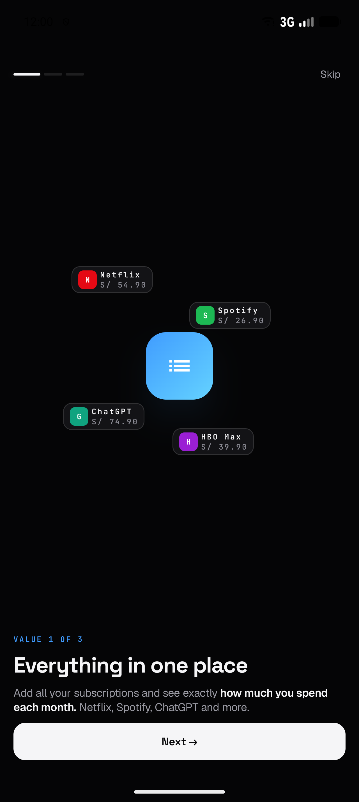
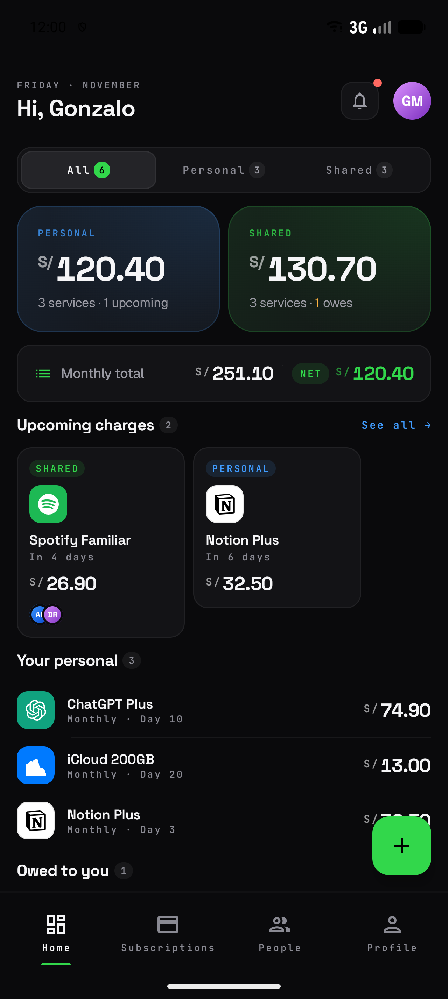
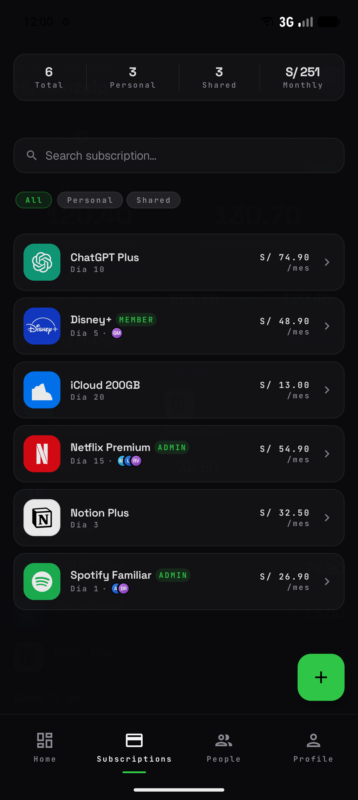
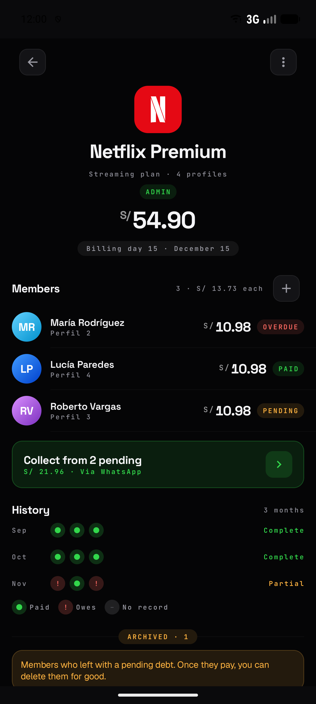
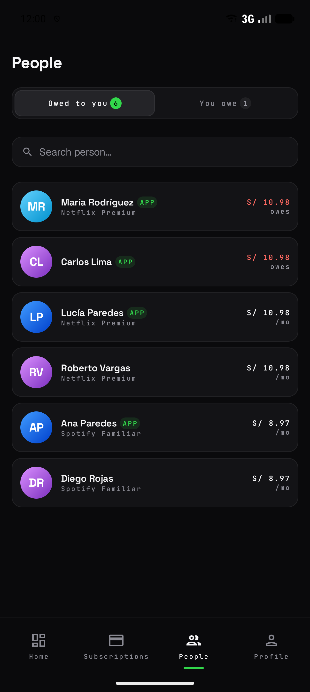
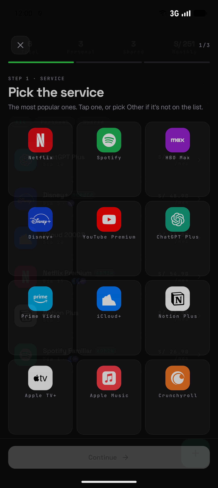

# SubTrack


**Track your personal and shared subscriptions and collect each member's share over WhatsApp — without processing payments.**

SubTrack is an Android and iOS app for organizing subscriptions like Netflix, Spotify or YouTube Premium, alone or split with friends and family. The admin collects from members through WhatsApp messages the app writes for them; the app only coordinates and never moves money. Built for Latin America, with Peru first (prices in S/ PEN), in Spanish and English.

---

## Screenshots

| | | |
|:---:|:---:|:---:|
|  |  |  |
| **Onboarding** | **Home** | **Subscriptions** |
|  |  |  |
| **Shared subscription (admin)** | **People** | **Create subscription** |

Android emulator, debug build with demo data. Regenerate with `docs/screenshots/capture.sh`.

---

## Features

| Feature | Detail |
|---|---|
| Personal and shared subscriptions | A 3-step wizard (5 when shared): service, who pays, details, members and split (equal, percentage or fixed) |
| Collecting over WhatsApp | Per-member and bulk reminders with editable message templates; the app opens WhatsApp with the text ready, the user sends it |
| Payment tracking | Paid, pending, overdue and late per member and month, with a 3-month history and punctuality |
| People | "Owed to you" and "You owe" across every subscription; people from paused subscriptions stay listed, dimmed |
| Home dashboard | Personal and shared totals, upcoming charges, debtors and a hint for unused subscriptions |
| Account and sync | Google sign-in; data saved locally (Room) and mirrored to Firestore under the user's account, works offline |
| Account deletion | Deletes the cloud data and the account after a fresh sign-in, and clears the device |
| Settings | CSV export as a file, notification and language settings, share and rate the app, open source licenses, contact mail |
| Notifications | Permission asked after the first subscription, never at launch (reminders themselves are not sent yet) |
| Minimum version | Reads `config/app` from Firestore and asks to update when the build is too old; never blocks offline |
| Languages | Spanish (default) and English, following the system's per-app language |
| Pro plan and referrals | Screens only, with demo data: there is no billing or referral backend yet |

---

## Tech Stack

- **Kotlin Multiplatform** 2.4 — Android and iOS share the UI, ViewModels, domain and data
- **Compose Multiplatform** 1.12 with Material 3, `composeResources` for strings, fonts and logos
- **Koin** 4.2 for dependency injection
- **Room KMP** with `sqlite-bundled` and **DataStore Preferences** for local data
- **Firebase** Auth and Firestore: Android SDK on Android, Swift packages on iOS behind small Kotlin interfaces
- **Google sign-in**: Credential Manager on Android, GoogleSignIn on iOS
- **Navigation Compose** (type-safe routes), **kotlinx-datetime**, **kotlinx.serialization**
- **Coil 3** with Ktor (OkHttp / Darwin) for profile photos
- Tests: kotlin.test and Turbine in `commonTest` (run on JVM and iOS), Robolectric + Roborazzi screenshots, Maestro end-to-end flows

---

## Architecture

Clean Architecture with MVVM. Repositories work on an in-memory store (`AppStore`); `LocalStoreSync` persists it to Room row by row and `FirestoreSync` mirrors it to Firestore.

```
androidApp/                 # Android entry point: Application, MainActivity, manifest, signing, R8
composeApp/src/
├── commonMain/             # Everything shared
│   ├── core/               # Design system, navigation, config, formatters
│   ├── data/               # local/ (Room), remote/ (Firestore sync), repository/, demo/
│   ├── domain/             # Models, repository interfaces, use cases (pure Kotlin)
│   ├── feature/            # onboarding/ dashboard/ subscriptionlist/ subscriptiondetail/ createsubscription/ people/ profile/
│   ├── platform/           # Interfaces each platform implements (Firebase, sharing, sign-in, QR, photo picker)
│   └── di/                 # Koin modules
├── androidMain/            # Android implementations (Firebase SDK, Credential Manager, intents, ZXing)
├── iosMain/                # iOS implementations and the bridges Swift implements
├── commonTest/             # Tests that run on both platforms
└── androidHostTest/        # Robolectric, Room and screenshot tests
iosApp/                     # SwiftUI host, Firebase/GoogleSignIn bridges (NativeBridges.swift), xcconfig
```

Decisions that depart from the studio's KMP base are in [docs/DECISIONES.md](docs/DECISIONES.md). [ARCHITECTURE.md](ARCHITECTURE.md) describes the app before the Kotlin Multiplatform migration.

---

## Requirements & Setup

| Tool | Version |
|---|---|
| JDK | 21 (Gradle toolchain) |
| Android Studio / AGP | AGP 9.1.1, compileSdk 37 |
| Xcode | builds with Xcode 27.2 (iOS deployment target 16.0) |

Files that are **not in the repository** (public repo) and that you need for sign-in and sync:

- `androidApp/google-services.json` — from the Firebase console, project `subtrack-f4dd3`
- `iosApp/iosApp/GoogleService-Info.plist` — same project, iOS app `com.gondroid.subtrack`
- `iosApp/Configuration/Secrets.xcconfig` — copy `Secrets.xcconfig.example` and set `TEAM_ID` and `GOOGLE_REVERSED_CLIENT_ID`
- Release signing keys in `local.properties` (`subtrack.signing.*`)

Without the Firebase files the app still builds and runs; sign-in and sync fail. Debug builds accept a fake sign-in (`fakeAuth` intent extra on Android, `-fakeAuth` launch argument on iOS) that loads demo data.

```bash
./gradlew :androidApp:installDebug                 # Android
./gradlew :composeApp:testAndroidHostTest          # JVM tests
./gradlew :composeApp:iosSimulatorArm64Test        # common tests on the iOS simulator
./gradlew :androidApp:lintDebug                    # lint, also covers composeApp
.maestro/run.sh                                    # end-to-end flows on a running emulator
```

iOS: open `iosApp/iosApp.xcodeproj` in Xcode and run the `iosApp` scheme (the build phase compiles the Kotlin framework with Gradle).

---

## Business model

- **Free**: up to 2 shared subscriptions
- **Pro**: unlimited, plus advanced stats
- **Referrals**: 1 active invitee = 1 free month of Pro for both

Pro and referrals are designed but not live yet (see Features).

---

## Design System

The full design system is documented in [DESIGN_TOKENS.md](DESIGN_TOKENS.md):

- Dark-first palette (true blacks, not grays); text and accents pass WCAG AA on every surface, checked by `ContrastTest`
- Typography: Space Grotesk (display) · Geist (body) · JetBrains Mono (technical), bundled with the app
- 8pt grid · defined radii · semantic elevations
- Motion: spring curves and standard durations

---

## Roadmap

| Milestone | Description | Status |
|---|---|---|
| M1 | Scaffolding · Design system · Navigation | ✅ |
| M2 | Every screen with demo data | ✅ |
| M3 | Firebase Auth + Firestore, Room offline cache | ✅ |
| M4 | Payment tracking + WhatsApp collecting | ✅ |
| M5 | Kotlin Multiplatform: Android + iOS | ✅ |
| M6 | FCM reminders + Pro/Freemium billing | 🔜 |

---

## Versioning

Current release: **0.1.0** (versionCode 1 · iOS build 1)

This project follows [Semantic Versioning](https://semver.org/). The full release history lives in [CHANGELOG.md](CHANGELOG.md).

---

## Privacy

The app links its privacy policy and terms from Settings and the sign-in screen: [Privacy policy](https://nekodojo.app/en/apps/subtrack/privacy) · [Terms](https://nekodojo.app/en/apps/subtrack/terms).

---

## License

Copyright © 2026 <!-- TODO: titular del copyright -->. All rights reserved.

This source code is proprietary. It may be viewed for reference, but it may not be copied, modified, redistributed, or published to any app store without written permission.

Service names and logos belong to their respective owners. The license above covers this application's source code only, not third-party trademarks.
